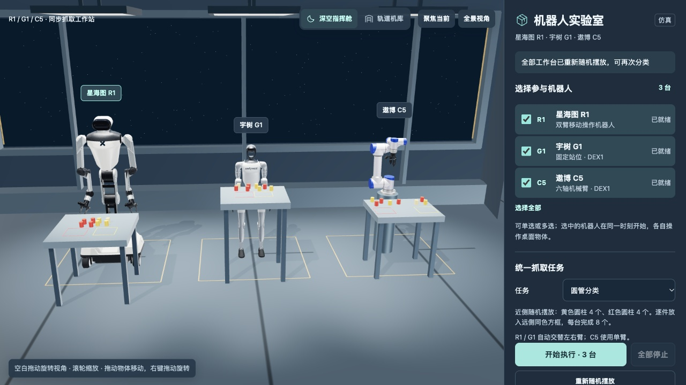
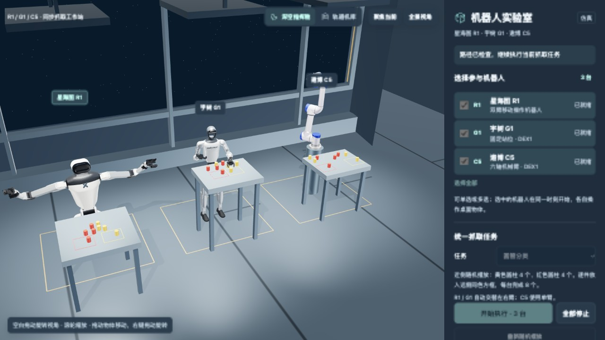
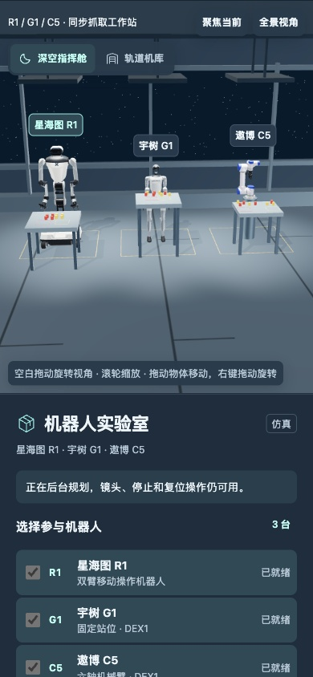

**English** · [简体中文](README.zh-CN.md)

# Orbit Manipulation Lab

Three robots. Independent workbenches. Coordinated starts.

Explore **Galaxea R1, Unitree G1 and AUBO C5** in a browser. Move objects, choose your robots, and run grasping, stacking or pipe sorting side by side—with **MuJoCo contact physics**, not objects attached to animated hands.

**[Open the lab](https://wander521.github.io/r1-simulator/)** · [Quick start](#run-locally) · [Engineering guide](GUIDE.md)



Actual browser capture. The application UI is currently Chinese. The display name is **Orbit Manipulation Lab**; the repository and Pages URL remain `r1-simulator`.

## What makes it interesting

- **Three robots, your selection.** Run one, two or all three. Independent physical worlds use **1 ms steps**, each robot operating its own table. The first action starts together; subsequent planning pauses only its own workbench.
- **Three task families.** Color sorting, blue → red → yellow stacking, and eight-pipe sorting per workbench. R1/G1 alternate arms; C5 uses one arm.
- **Inspect the physics.** Wrist-camera views, contact forces, actuator torques and tracking errors come from execution. Success requires contact, lift, release and stable support.
- **Background path planning.** Per-robot Web Workers handle candidate paths, IK and collision search. Camera control, stop and reset remain available; stale plans are discarded.
- **Two environments.** Switch between Deep-space Command Cabin and Orbital Hangar without resetting the scene or task.

<details>
<summary>See background planning and the mobile layout</summary>


<p></p>

These are recorded browser observations; see the [capture context and review](work/validation/background-planning/finish-review.md).

</details>

## Run locally

Use **Python 3** for the static server. **Node.js 22** is recommended for npm commands and tests. The browser needs WebGL2, WebAssembly and module Workers.

```sh
git clone https://github.com/wander521/r1-simulator.git
cd r1-simulator
npm start
```

Open **http://127.0.0.1:4173/multi/**. No `npm install`, app build or external inference service is needed; runtime libraries and models are included in `dist/`.

Without npm: `python3 -m http.server 4173 --bind 127.0.0.1 --directory dist`. Serve over HTTP rather than opening HTML from disk.

## Try a task

1. Select the robots and choose sorting, stacking or pipes in the sidebar.
2. Left-drag objects to move them; right-drag or Shift-drag to rotate. WASD moves the selected object. Drag empty space to orbit; scroll to zoom.
3. Start execution. Selected robots prepare together, then manipulate their own objects. Stop cancels pending work; reset/rerandomize starts a fresh pipe batch.

Camera observation and task participation are separate. Physical worlds wait together while planning; a responsive camera does not mean robot motion continues during that wait.

## Under the hood

```text
Task + object edits → shared coordinator
    → per-robot Worker: path search / IK / collision checks
    → validated commands → independent MuJoCo worlds, per-world 1 ms steps
    → actual joint/contact state → Three.js, cameras and live plots
```

| Read next | What is inside |
| --- | --- |
| [Engineering guide](GUIDE.md) · [中文](GUIDE.zh-CN.md) | Robot models, controls, architecture, setup and deployment |
| [Current performance evidence](work/validation/performance-v4/README.md) | All eight high/medium scan findings, independent scheduling, standalone Workers, model/geometry reuse and current regressions |
| [Previous performance release](work/validation/performance-v2/README.md) | Shipped exact-result planning cache, asynchronous camera readback and historical CI evidence |
| [Previous background-planning release](work/validation/background-planning/README.md) | Historical source-bound reports, cancellation and compiled-model consistency |
| [Implementation history](TECHNICAL_NOTES.zh-CN.md) | Preserved version and branch notes |

## Verify and contribute

```sh
npm test
npm run test:pages
npm run test:acceptance
```

Full physics runs take many minutes. The current [performance-v4 results](work/validation/performance-v4/README.md) passed complete local regression: 72 pipes, 12 ordinary grasps, three multi-robot stacks, 15 standalone checks, and 106/104 multi/pipe acceptance-verifier checks. Desktop and phone-sized browser layouts were also inspected. These are simulator tests, not hardware safety certification or a universal frame-rate guarantee. GitHub Actions reruns the complete regression before publishing.

The previous `ee380fb` release passed local and [GitHub CI](https://github.com/wander521/r1-simulator/actions/runs/39093502625) full regression: 72 pipes, 12 ordinary grasps and three stacks. Pages deployment succeeded; nine served files matched the tested bytes at that release. Those historical results remain under performance-v2 and do not certify this version.

`main` serves `/multi/`; `/r1/`, `/g1/` and `/c5/` remain available. GitHub Actions validates before publishing `dist/` to Pages. Bug reports should include the robot, task, layout/seed, browser and reproduction steps.

## Scope and credits

Fixed-base manipulation, not walking, learned end-to-end control or hardware safety certification. Objects are not welded or teleported during transport. Reachability and collision coverage vary by robot; R1 does not implement complete full-body self-collision.

Reference: [yang-ci/Rebot_Arm_AGV](https://yang-ci.github.io/Rebot_Arm_AGV/?variant=arm). Models and dependencies retain their own terms: [G1 provenance](dist/g1/assets/THIRD_PARTY.md), [C5 provenance](dist/c5/assets/THIRD_PARTY.md). C5's upstream license-text gap is recorded; no blanket license is asserted for all assets.
